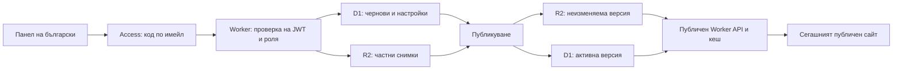

# Админ панел за Трънче: обхват и архитектурно решение

Статус: избрана Cloudflare архитектура за етап 2, 23.11.2026. Това е спецификация; няма изграден админ панел, създадени Cloudflare ресурси или прехвърлени данни. Визуалните промени по публичния сайт са в PR #65.

## Решението

Избран доставчик: **Cloudflare**. Изискването е **0 € месечен абонамент**, с работа в безплатните квоти. R2 е услуга с таксуване над квотите; безплатният пакет не е автоматичен твърд таван на сметката. Затова проектираме ограничения на приложението, контрол на използването и известия. Не активираме платени планове или допълнителни услуги. Съществуващият домейн е отделен текущ разход.

| Компонент | Роля |
| --- | --- |
| Собствен React + TypeScript + Vite панел | Български интерфейс на `admin.trunche.com` |
| Workers Free | Проверка на достъпа, API, качване и публикуване |
| D1 Free | Категории, предложения, чернови, албуми, настройки, роли и история |
| R2 Standard | Частни изображения и версии на публикуваното съдържание |
| Cloudflare Access | Вход с еднократен код до предварително одобрени имейли |
| Статичен хостинг | Публичният сайт запазва дизайна и адресите; панелът е отделен frontend build |

Основният критерий е човек от екипа да може сам да промени цена или да качи снимки от телефон. Интерфейсът следва задачите на екипа, без листове, файлови идентификатори, настройки за споделяне, HTML или имена на колони. Не разработваме собствена система за пароли.

Supabase и Sanity вече не са част от избраната архитектура. С Cloudflare ние разработваме редактора, API проверките, модела за публикуване и архивите; услугите не предоставят готов CMS. Разделяме този технически слой от простите екрани за служителите.

Не е необходима смяна на публичния сайт с Next.js само за да има админ. Не включваме онлайн поръчки, плащания, CRM или резервационен календар в този етап.

## Какво ще има в панела

| Раздел | Какво управлява екипът |
| --- | --- |
| Начало | Бутони „Добави предложение“ и „Качи снимки“, непубликувани промени, последна публикация и кой я е направил |
| Меню и цени | Категории и подкатегории, куверти, храна, напитки, варианти с отделни цени, включени предложения, грамаж/брой, бележки, видимост и подредба |
| Партньори и услуги | Аниматори, фотографи, декорация, портрет/лого, пакети/продължителност/цени и контакти; подменю в „Меню и цени“ |
| Галерия | Албуми, качване на няколко снимки, корица, надпис, описание за достъпност, подредба и скриване |
| Страници и контакти | Начални заглавия, описания и бутони; „За нас“, адрес, телефон, социални връзки и SEO заглавия/описания/споделена снимка |
| Съобщения и работно време | Работно време, условия за събития, отпуск/обяви, период, банер или прозорец, честота на показване и бутон за контакт |
| Настройки | Потребители и достъп, история/възстановяване; техническите настройки са само за собственика |

Условията и важните бележки се редактират с познати полета: заглавие, текст, списък. Поддържаме ограничено форматиране и връзки, без произволен HTML. Дизайнът определя как изглеждат блоковете.

## Три основни работни потока

### Добавяне на предложение

„Меню и цени“ → категория → „Добави предложение“ → име, цена, порция и описание → по желание снимка → „Запази чернова“ → „Преглед“ → „Публикувай“.

Първо се виждат само нужните полета. За куверт има списък „Какво включва“. За продукт с варианти има отделни редове с име, количество и цена. Допълнителните настройки са сгънати. До формата се вижда картата така, както ще изглежда на сайта. Дублиране на съществуващо предложение ускорява сходните продукти.

Снимката има „Качи“, „Избери от библиотеката“, „Смени“ и „Премахни“. Премахване на снимката не премахва продукта. Снимката не е задължителна: продуктът трябва да изглежда добре и без нея.

### Качване в галерията

„Галерия“ → албум → „Добави снимки“ → избор от телефона/компютъра → преглед на миниатюрите → корица/подредба/описания → запазване и публикуване.

Всяка снимка има собствен напредък, успех или разбираема грешка. При неуспешна снимка се повтаря само тя; успешните не се губят. Албумът се избира с име, а не чрез преименуване на файла. Подредбата работи с влачене и с достъпни бутони „Нагоре/Надолу“.

### Промяна на цена или скриване

От списъка се отваря продуктът, сменя се цената и се публикува. Цената приема `14,50` и `14.50`, а в базата се записва като 1450 цента. Вариантът „Скрий от сайта“ пази записа и снимката за бъдеща употреба. Изтриването премества в кошче; не извършваме незабавно необратимо изтриване от обичайния екран.

## Правила за интуитивна работа

- Един основен бутон на екран; ясни състояния „Има незапазени промени“, „Запазено като чернова“, „Публикувано“.
- Запазване и публикуване са отделни действия. Черновата не променя публичния сайт.
- Прегледът използва същите компоненти/визуализация като сайта, а не приблизително копие.
- При грешка запазваме въведения текст и показваме проблема до конкретното поле.
- Предупреждение при напускане на незапазена форма. За първата версия изрично „Запази“, без двусмислено автоматично публикуване.
- За снимките: големи миниатюри, избор от съществуващите, изрязване с визуален преглед и фокусна точка.
- При едновременно редактиране се проверява версията на записа; чужда промяна не се презаписва мълчаливо.
- Работи от телефон с камера/фотобиблиотека, големи бутони и без хоризонтално превъртане.
- Подсказките са за съдържанието („Цена за една порция“), не за инфраструктурата.

## Данни и публикуване

Браузърът няма директни D1/R2 права. Worker проверява всяка административна заявка. При публикуване валидира записите и версиите им, проверява готовността на снимките и записва неизменяем JSON snapshot в R2. След успешното подготвяне активира release чрез атомарно обновяване на активната версия и журнала в D1. R2 и D1 нямат обща транзакция: при междинна грешка старият release остава активен, а недовършеният пакет се изчиства по-късно. Повторение със същия ключ на операцията не създава двойна публикация.

Публичният endpoint връща само активния snapshot и кешира отговора. Снимките се обслужват през отделен публичен Worker route с кеш, който допуска само assets на публикувани версии. Частният R2 bucket и черновите не са директно публични. Статичният сайт прави една заявка за съдържанието вместо поредица към Google Sheets. Публикуването на съдържание не изисква Git commit или нов build на frontend кода.

Панелът показва „Публикува се“, „На живо“ или разбираема грешка. „На живо“ се потвърждава чрез реално обслужваната версия. Нови редакции по време на публикация остават в следващата чернова. След публикуване инвалидиране/кратък кеш трябва да осигури видимост на новия release до 60 секунди при нормална връзка; това е критерий за приемане, а не вече проверено поведение.

При недостъпно API показваме последното успешно получено публикувано съдържание, когато има такова в браузърния кеш, с подходящо съобщение. Това не гарантира съдържание за първо посещение при пълна недостъпност на услугата. За аварийно връщане пазим export на публикуваната версия и статичните assets. Не използваме Supabase или неговите механизми за пауза при неактивност.

## Основни обекти

| Обект | Полета и правила |
| --- | --- |
| category / section | Стабилен ID/slug, име, описание, одобрена икона/цвят, подредба, видимост. Имената се четат от CMS, без сегашното твърдо зададено преименуване в `CATEGORY_UI` |
| menu_item | Вид продукт/куверт, категория, подкатегория, име, описание, порция, основна цена в евро, снимка, бележки, ред, видимост |
| item_variant / inclusion | Варианти с отделни цени, количества и единици; списък с включени предложения. Без цени, скрити само в свободен текст |
| partner / offer | Отделен тип за партньор, контакти, портрет/лого и услуги с продължителност/цена; наличието на снимка не определя типа |
| media_asset | ID, частно редакционно копие, публични производни, формат, размери, alt, изрязване/фокусна точка, статус на обработката |
| album / album_photo | Име/подредба на албума, корица, свързани assets, надпис и ред на всяка снимка |
| page / content_block | Контролирани текстови блокове, условия, списъци и SEO полета; без Bootstrap класове в редактора |
| site_settings | Контакти, социални профили, работно време, базови настройки за поканата |
| announcement | Заглавие, текст, начало/край, видимост, банер/прозорец, честота и връзка/надпис на бутона |
| content_release / audit_event | Публикувана версия, автор/време, активна версия, журнал на промените и основание за възстановяване |

Всички цени са само в евро (EUR). В базата се записват като цели числа в евроцентове: `14,50 €` → `1450`. Панелът няма поле за избор на валута, курс или двойно показване. Публичният сайт показва само цени в евро. При импорта проверяваме, че текущите цени са в евро; евентуални стари стойности в друга валута се отбелязват за преглед, вместо да се пренасят или преобразуват мълчаливо. Сегашната логика за двойно показване се премахва при свързването на новия източник.

Периодите на съобщенията са по `Europe/Sofia`, с изрична включителна крайна дата. Прегледът показва какво ще се вижда по време на периода и какво преди него. Поддържаме сегашните честоти на модала, но съобщението и бутонът се редактират от панела.

## Снимки и библиотека

Оразмеряването, изрязването и WebP/JPEG компресията се правят **в браузъра преди качване**, с безплатни браузърни API. Не използваме платена услуга за image transformations. Прегледът показва точно оптимизирания файл, който ще се запази.

Първата версия приема JPEG, PNG и WebP. HEIC не се обещава чрез платена услуга; локален конвертор с отворен код е отделна възможност само след проверка с реални телефони и подходящ лиценз. При неподдържан формат показваме ясна причина и подходящите формати. SVG и други файлове не се приемат като фотографии.

Предложен входен лимит за браузърната обработка: 20 MB / 40 MP. След обработката качваният файл трябва да е до 2 MB, а целевите публични копия са приблизително 100–400 KB. Правим размери около 480/960 px за карти и 1600–2000 px за голям преглед. Сървърът валидира действителния формат и размера; клиентската обработка сама по себе си не е защита. Публичните копия се проверяват за ориентация и липса на GPS metadata.

В безплатното хранилище пазим оптимизирани редакционни копия и черновите, а не всеки многомегабайтов оригинал от камерата. Оригиналът остава на устройството на качващия. Частният преглед минава през защитения Worker API. При публикуване оптимизираните версии се включват в release-а и се получават през публичния image route с нов адрес при смяна. Една снимка може да се използва на няколко места; не премахваме файлове, нужни за активна или запазена публикация.

Показваме използваното място и предупреждение преди изчерпване. Приложението има собствен лимит под квотата на доставчика, запазва резерв за чернови/история и не включва платено надвишаване. Оценяваме и размера на запазените release-и и кеша — компресията не прави мястото неограничено.

## Достъп, възстановяване и поддръжка

- Access е пред `admin.trunche.com` и всички административни API маршрути. Входът е с еднократен код по имейл, без Google OAuth, собствена парола или отделна SMTP услуга. Изрично конфигурираме OTP; не приемаме, че е включено по подразбиране.
- Worker валидира Access JWT: подпис, issuer, audience и срок, след това проверява одобрения имейл и ролята в D1. Не се доверява на гол header с имейл. Предотвратяваме обход през незащитен `workers.dev` адрес и алтернативни маршрути.
- Редактор: съдържание, качване, преглед и публикуване. Собственик: тези права плюс управление на списъка с потребители, възстановяване и export. Достъп се дава само ако едновременно го разрешават Access политиката и активният запис в D1; отнемането се проверява на всяка API операция.
- D1 и R2 bindings са само в Worker. Проверяваме схемата на входните данни, разрешените операции, произхода на променящите заявки и ограниченията за размер/честота. Скрит бутон не е защита.
- Качването и доставката на снимки минават през Worker. R2 bucket не се излага чрез публичен `r2.dev` адрес. Не предоставяме неограничени директни upload URL адреси, които заобикалят приложните квоти.
- Журнал на редакции/публикации, кошче с предложен срок 30 дни и връщане към предишен release. Старите файлове остават, докато са нужни за възстановяване.
- D1 Free има 7-дневен Time Travel; това не е архив на самите R2 файлове. Предоставяме export на данните и медията за независим backup, с реален тест за възстановяване. Автоматизирането на независими архиви трябва също да се вмести в безплатни услуги.
- Преди конфигурация проверяваме DNS на домейна и достъпа до Cloudflare. Предпочитанието за CF не означава, че DNS, Access политики или cloud ресурси вече са променени. Регионалното разполагане/юрисдикцията на D1 и R2 се уточняват отделно; не обещаваме еднаква EU гаранция за всеки продукт.

### Квоти и бюджет

Проверени към 23.11.2026: Workers Free — 100 000 заявки дневно; D1 Free — 500 MB на база, 5 GB общо за акаунта, 5 млн. прочетени и 100 000 записани реда дневно; R2 Standard — 10 GB-month място, 1 млн. Class A и 10 млн. Class B операции месечно, без egress такса. Квотите са на акаунт/план и се споделят с други приложения. Планът за Access и броят редактори също се проверяват преди пускане.

Предложен приложен лимит: до 8 GB сумарно R2 място, с резервиране на място преди upload и контролирано изчистване на неизползвани файлове. Следим отделно броя операции, броя release-и и дневните API заявки. Публичното разглеждане не трябва да причинява R2 `LIST` операции. Кешът намалява прочитите, но не отменя квотата за Worker заявки.

R2 таксува над безплатните квоти и няма обещание за автоматичен твърд финансов таван. Ограниченията, rate limiting и известията намаляват риска, но не са гаранция за нулева сметка при всякакъв трафик или чуждо потребление в същия акаунт. При достигане на зададени прагове приложението спира съответните операции вместо автоматичен upgrade. Преди реално включване се проверяват актуалните billing условия.

## Как се отделяме от Google

| Сегашна зависимост | Замяна |
| --- | --- |
| `_index` и шестте Sheets категории | Структурирани категории, записи и настройки в D1 |
| Позиционни `list`/`line` редове и свободни HTML блокове | Изрично свързани варианти/списъци и ограничен текстов редактор |
| Публична Drive папка и категории от имена на файлове | Media assets и албуми с имена/ред от панела |
| Drive thumbnails, включително резервният списък | Оптимизирани копия и нови image URLs — не оставяме старите thumbnail адреси |
| CSV конфигурация за отпуск | Announcement записи и настройки за показване |
| Контакти и текстове в HTML | Страници и site settings |
| Неизползван Maps JavaScript SDK с ключ | Премахва се; картата се решава отделно чрез обикновена външна връзка/карта без API ключ, без Google да участва в управлението на съдържанието |

Контактната форма (EmailJS) и генераторът на PDF покана са отделни работещи функции и се запазват. Получателят на контактната форма е техническа конфигурация, а не свободно редактирано публично поле. Фонът на поканата в момента е външен Imgur ресурс: копираме допустимия оригинал в управляваните assets при миграцията, за да няма скрита зависимост и там. Проверяваме поканата докрай след прехвърлянето.

## Последователност за реализация

1. **Екрани с тестови данни.** Вход, списък/редакция на продукт, снимка към продукт, албум с пакетно качване и преглед. Проверяваме с човек от екипа дали задачите са ясни, преди да фиксираме останалите екрани.
2. **Работеща основа.** Cloudflare Worker, D1 миграции, частен R2 bucket, Access OTP, роли, частно качване, браузърна обработка на изображения, чернови и публикации. Разработваме и отрицателните сценарии за достъп.
3. **Пълен обхват.** Куверти, варианти, партньори, правила, съобщения, текстове, контакти, цени само в евро, история и възстановяване.
4. **Еднократен импорт.** Нов export от всички текущи листове и CSV, 87-те известни снимки, оптимизирани преди импорт, в четири албума и партньорските изображения. Правим нова инвентаризация в деня на импорта, защото съдържанието може да се е променило.
5. **Проверка на съответствието.** Автоматични отчети и човешко сравнение за всеки запис, цена в евро, включено предложение, условие и снимка; правилно свързване на `list`/`line` към предхождащия продукт и преобразуване на дати.
6. **Паралелен преглед и превключване.** Новият content adapter подава данни на сегашния дизайн. Запазваме URL адресите и category anchor IDs. След приемане премахваме активните заявки, ключове и fallback връзки към Sheets/Drive и имаме готова предишна публикация за връщане.

## Критерии за готовност

- Човек от екипа добавя продукт със снимка от телефон и променя цена без помощ от разработчик.
- Пакетно качване, корица, подредба, смяна/премахване на снимка и повторение на неуспешно качване работят с реални JPEG/PNG/WebP файлове от телефон. Неподдържаните файлове имат разбираема грешка.
- Черновата не е публична, публикуването е цялостно и старият сайт не се поврежда при грешка.
- Непоканен/неоторизиран потребител не може да чете чернови, да променя съдържание или да качва файлове.
- Прекъсната връзка, конфликт между редактори и невалидно съдържание не губят въведеното и не причиняват частично публикуване.
- Всички сегашни функции са проверени: търсене и категории, цени само в евро, партньори, условия/работно време, отпуск, галерия/lightbox, контакти и PDF покана.
- Работещият сайт не заявява данни или снимки от Google Sheets/Drive. Backup на данни и медия е възстановен успешно в тестова среда.

## Проверени официални източници

- [Workers: квоти и цени](https://developers.cloudflare.com/workers/platform/pricing/)
- [D1: цени](https://developers.cloudflare.com/d1/platform/pricing/)
- [D1: размер на база и Time Travel](https://developers.cloudflare.com/d1/platform/limits/)
- [R2: безплатни квоти и таксуване над тях](https://developers.cloudflare.com/r2/pricing/)
- [Access: еднократен код по имейл](https://developers.cloudflare.com/cloudflare-one/integrations/identity-providers/one-time-pin/)
- [Access: проверка на JWT в origin приложението](https://developers.cloudflare.com/cloudflare-one/access-controls/applications/http-apps/authorization-cookie/validating-json/)
