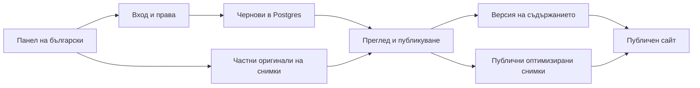

# Админ панел за Трънче: обхват и архитектурно решение

Статус: предложение за разработка на етап 2, 22.11.2026. Това е спецификация; няма изграден админ панел, създаден Supabase проект или прехвърлени данни. Визуалните промени по публичния сайт са в PR #65.

## Решението

Собствен, адаптивен админ интерфейс на български с React + TypeScript + Vite, обслужван на `/admin/` от статичния хостинг. Supabase осигурява Postgres, удостоверяване, съхранение на файлове и сървърни функции. Публичният сайт запазва новия дизайн и сегашните адреси; получава само публикуваното съдържание през един API endpoint.

Основният критерий е човек от екипа да може сам да промени цена или да качи снимки от телефон. Интерфейсът следва задачите на екипа, без листове, файлови идентификатори, настройки за споделяне, HTML или имена на колони.

Това заменя предварителната препоръка за Sanity Studio. Sanity остава работеща алтернатива и поддържа персонализирани форми и локализация; изборът на собствен панел е заради пълния контрол върху конкретните работни екрани. Цената на този контрол е повече първоначална разработка и наша отговорност за редактора, публикуването и тестовете. Не разработваме собствена система за пароли или собствено файлово хранилище.

| Подход | Предимство за този проект | Компромис |
| --- | --- | --- |
| Собствен панел + Supabase — препоръка | Напълно български интерфейс с няколко ясни задачи, управление от телефон и една библиотека със снимки | Ние изграждаме и поддържаме редактора и публикациите |
| Sanity Studio | Готов CMS, който може да се конфигурира и персонализира | Изисква адаптиране на CMS работния модел към задачите на екипа; планът и правата трябва да се проверят |
| Файлове/JSON, редактирани през Git | Малко инфраструктура | Редактирането на съдържание остава техническа задача и не изпълнява основната цел |

Не е необходима смяна на публичния сайт с Next.js само за да има админ. Не включваме онлайн поръчки, плащания, CRM или резервационен календар в този етап.

## Какво ще има в панела

| Раздел | Какво управлява екипът |
| --- | --- |
| Начало | Бутони „Добави предложение“ и „Качи снимки“, непубликувани промени, последна публикация и кой я е направил |
| Меню и цени | Категории и подкатегории, куверти, храна, напитки, варианти с отделни цени, включени предложения, грамаж/брой, бележки, видимост и подредба |
| Партньори и услуги | Аниматори, фотографи, декорация, портрет/лого, пакети/продължителност/цени и контакти; подменю в „Меню и цени“ |
| Галерия | Албуми, качване на няколко снимки, корица, надпис, описание за достъпност, подредба и скриване |
| Страници и контакти | Начални заглавия, описания и бутони; „За нас“, адрес, телефон, социални връзки и SEO заглавия/описания/споделена снимка |
| Съобщения и работно време | Работно време, условия за събития, отпуск/обяви, период, банер или прозорец, честота на показване и бутон за контакт |
| Настройки | Потребители и достъп, валута и настройки за двойно показване, история/възстановяване; техническите настройки са само за собственика |

Условията и важните бележки се редактират с познати полета: заглавие, текст, списък. Поддържаме ограничено форматиране и връзки, без произволен HTML. Дизайнът определя как изглеждат блоковете.

## Три основни работни потока

### Добавяне на предложение

„Меню и цени“ → категория → „Добави предложение“ → име, цена, порция и описание → по желание снимка → „Запази чернова“ → „Преглед“ → „Публикувай“.

Първо се виждат само нужните полета. За куверт има списък „Какво включва“. За продукт с варианти има отделни редове с име, количество и цена. Допълнителните настройки са сгънати. До формата се вижда картата така, както ще изглежда на сайта. Дублиране на съществуващо предложение ускорява сходните продукти.

Снимката има „Качи“, „Избери от библиотеката“, „Смени“ и „Премахни“. Премахване на снимката не премахва продукта. Снимката не е задължителна: продуктът трябва да изглежда добре и без нея.

### Качване в галерията

„Галерия“ → албум → „Добави снимки“ → избор от телефона/компютъра → преглед на миниатюрите → корица/подредба/описания → запазване и публикуване.

Всяка снимка има собствен напредък, успех или разбираема грешка. При неуспешна снимка се повтаря само тя; успешните не се губят. Албумът се избира с име, а не чрез преименуване на файла. Подредбата работи с влачене и с достъпни бутони „Нагоре/Надолу“.

### Промяна на цена или скриване

От списъка се отваря продуктът, сменя се цената и се публикува. Цената приема `14,50` и `14.50`, а в базата се записва като 1450 цента. Вариантът „Скрий от сайта“ пази записа и снимката за бъдеща употреба. Изтриването премества в кошче; не извършваме незабавно необратимо изтриване от обичайния екран.

## Правила за интуитивна работа

- Един основен бутон на екран; ясни състояния „Има незапазени промени“, „Запазено като чернова“, „Публикувано“.
- Запазване и публикуване са отделни действия. Черновата не променя публичния сайт.
- Прегледът използва същите компоненти/визуализация като сайта, а не приблизително копие.
- При грешка запазваме въведения текст и показваме проблема до конкретното поле.
- Предупреждение при напускане на незапазена форма. За първата версия изрично „Запази“, без двусмислено автоматично публикуване.
- За снимките: големи миниатюри, избор от съществуващите, изрязване с визуален преглед и фокусна точка.
- При едновременно редактиране се проверява версията на записа; чужда промяна не се презаписва мълчаливо.
- Работи от телефон с камера/фотобиблиотека, големи бутони и без хоризонтално превъртане.
- Подсказките са за съдържанието („Цена за една порция“), не за инфраструктурата.

## Данни и публикуване

Редакторските таблици са частни за посетители. Публикуването е сървърна операция, която проверява правата, валидира всички връзки/цени/дати, подготвя нужните изображения и създава неизменяема версия на съдържанието. След успешното подготвяне база данни сменя активната версия с една транзакция. При грешка старата публикация остава активна.

Публичният endpoint връща само активната публикация — без чернови, потребители и административни полета. Сайтът прави една заявка за съдържанието, вместо поредица от заявки към листове. Кратък HTTP кеш и версия на отговора ограничават излишните заявки; цел за приемане е новата публикация да се вижда в рамките на 60 секунди при нормална връзка. Прегледът на черновите изисква вход и не се кешира публично.

Не правим Git commit и нов frontend deployment при всяка промяна на цена. Кодът се публикува отделно от ежедневното съдържание.

## Основни обекти

| Обект | Полета и правила |
| --- | --- |
| category / section | Стабилен ID/slug, име, описание, одобрена икона/цвят, подредба, видимост. Имената се четат от CMS, без сегашното твърдо зададено преименуване в `CATEGORY_UI` |
| menu_item | Вид продукт/куверт, категория, подкатегория, име, описание, порция, основна цена, валута, снимка, бележки, ред, видимост |
| item_variant / inclusion | Варианти с отделни цени, количества и единици; списък с включени предложения. Без цени, скрити само в свободен текст |
| partner / offer | Отделен тип за партньор, контакти, портрет/лого и услуги с продължителност/цена; наличието на снимка не определя типа |
| media_asset | ID, частен оригинал, публични производни, формат, размери, alt, изрязване/фокусна точка, статус на обработката |
| album / album_photo | Име/подредба на албума, корица, свързани assets, надпис и ред на всяка снимка |
| page / content_block | Контролирани текстови блокове, условия, списъци и SEO полета; без Bootstrap класове в редактора |
| site_settings | Контакти, социални профили, работно време, валутни настройки, базови настройки за поканата |
| announcement | Заглавие, текст, начало/край, видимост, банер/прозорец, честота и връзка/надпис на бутона |
| content_release / audit_event | Публикувана версия, автор/време, активна версия, журнал на промените и основание за възстановяване |

Парите са цели числа в малки парични единици, с отделна валута. Двойното показване запазва сегашните възможности: включено/изключено, крайна дата, водеща валута, курс и изключение за конкретен запис. Не преобразуваме повторно вече прехвърлени цени.

Периодите на съобщенията са по `Europe/Sofia`, с изрична включителна крайна дата. Прегледът показва какво ще се вижда по време на периода и какво преди него. Поддържаме сегашните честоти на модала, но съобщението и бутонът се редактират от панела.

## Снимки и библиотека

Започваме с управляваните image transformations на Supabase, което според актуалната документация изисква Pro или по-висок план. Документираният вход включва и HEIC; публичният резултат за такъв вход е JPEG/WebP, не HEIC. Това е подходящо за снимки от телефон, но се проверява с реални файлове преди приемане.

Предложени лимити на приложението: до 20 MB и 40 MP на оригинал. Размерите/типът се валидират и на сървъра. Поддържаме JPEG, PNG, WebP и HEIC; SVG и други файлове не се приемат като потребителски фотографии. Публичните копия се проверяват за ориентация и липса на GPS metadata. Размери за доставка: приблизително 480/960 px за карти и 1600–2000 px за голям преглед, с подходящо изрязване.

Оригиналите и черновите са в частно хранилище; прегледът ползва краткотрайни подписани връзки. Оптимизираните публични копия получават нов адрес при смяна, за да няма „старата снимка от кеша“. Една снимка може да се използва на няколко места. Панелът показва къде е използвана и не допуска премахване на asset, необходим за активна или запазена публикация.

## Достъп, възстановяване и поддръжка

- Вход с имейл и парола, профили само с покана, без зависимост от Google вход.
- Редактор: съдържание, качване, преглед и публикуване. Собственик: тези права плюс управление на потребителите и възстановяване на публикации.
- Правата се проверяват в базата и Storage, както и в сървърните операции. Скрит бутон не е защита. Обикновен влязъл потребител без редакторска роля няма административен достъп.
- Административният ключ е само на сървъра. Панелът ползва обичайната потребителска сесия и публичния клиентски ключ с подходящи политики.
- Настройваме собствен SMTP за покани и възстановяване на пароли, вместо да разчитаме на изпращане само за тестови цели.
- Журнал за редакции/публикации, кошче с предложен срок 30 дни и връщане към предишна публикация. Старите файлове се пазят, докато са нужни за това връщане.
- Отделно архивиране на базата **и** снимките. Supabase database backups не включват самите Storage файлове. Възстановяването се тества преди пускане.
- Избираме EU регион и задаваме контрол върху разходите. Разходите включват план, storage/трафик, обработени изображения, имейли и независим backup; не обещаваме безплатна продукционна система. Точният бюджет се сверява с текущия план преди създаване на услуги.

## Как се отделяме от Google

| Сегашна зависимост | Замяна |
| --- | --- |
| `_index` и шестте Sheets категории | Структурирани категории, записи и настройки в Postgres |
| Позиционни `list`/`line` редове и свободни HTML блокове | Изрично свързани варианти/списъци и ограничен текстов редактор |
| Публична Drive папка и категории от имена на файлове | Media assets и албуми с имена/ред от панела |
| Drive thumbnails, включително резервният списък | Импортирани оригинали и нови image URLs — не оставяме старите thumbnail адреси |
| CSV конфигурация за отпуск | Announcement записи и настройки за показване |
| Контакти и текстове в HTML | Страници и site settings |
| Неизползван Maps JavaScript SDK с ключ | Премахва се; картата се решава отделно чрез обикновена външна връзка/карта без API ключ, без Google да участва в управлението на съдържанието |

Контактната форма (EmailJS) и генераторът на PDF покана са отделни работещи функции и се запазват. Получателят на контактната форма е техническа конфигурация, а не свободно редактирано публично поле. Фонът на поканата в момента е външен Imgur ресурс: копираме допустимия оригинал в управляваните assets при миграцията, за да няма скрита зависимост и там. Проверяваме поканата докрай след прехвърлянето.

## Последователност за реализация

1. **Екрани с тестови данни.** Вход, списък/редакция на продукт, снимка към продукт, албум с пакетно качване и преглед. Проверяваме с човек от екипа дали задачите са ясни, преди да фиксираме останалите екрани.
2. **Работеща основа.** Supabase проект, миграции на схемата, права, потребителски вход, частно качване, обработка на изображения, чернови и публикации. Разработваме и отрицателните сценарии за достъп.
3. **Пълен обхват.** Куверти, варианти, партньори, правила, съобщения, текстове, контакти, валутни настройки, история и възстановяване.
4. **Еднократен импорт.** Нов export от всички текущи листове и CSV, оригиналите на 87-те известни снимки в четири албума и партньорските изображения. Правим нова инвентаризация в деня на импорта, защото съдържанието може да се е променило.
5. **Проверка на съответствието.** Автоматични отчети и човешко сравнение за всеки запис, цена, валута, включено предложение, условие и снимка; правилно свързване на `list`/`line` към предхождащия продукт и преобразуване на дати.
6. **Паралелен преглед и превключване.** Новият content adapter подава данни на сегашния дизайн. Запазваме URL адресите и category anchor IDs. След приемане премахваме активните заявки, ключове и fallback връзки към Sheets/Drive и имаме готова предишна публикация за връщане.

## Критерии за готовност

- Човек от екипа добавя продукт със снимка от телефон и променя цена без помощ от разработчик.
- Пакетно качване, корица, подредба, смяна/премахване на снимка и повторение на неуспешно качване работят с реални файлове, включително HEIC.
- Черновата не е публична, публикуването е цялостно и старият сайт не се поврежда при грешка.
- Непоканен/неоторизиран потребител не може да чете чернови, да променя съдържание или да качва файлове.
- Прекъсната връзка, конфликт между редактори и невалидно съдържание не губят въведеното и не причиняват частично публикуване.
- Всички сегашни функции са проверени: търсене и категории, цени/валути, партньори, условия/работно време, отпуск, галерия/lightbox, контакти и PDF покана.
- Работещият сайт не заявява данни или снимки от Google Sheets/Drive. Backup на данни и медия е възстановен успешно в тестова среда.

## Проверени официални източници

- [Supabase: RLS](https://supabase.com/docs/guides/database/postgres/row-level-security)
- [Supabase: Storage access control](https://supabase.com/docs/guides/storage/security/access-control)
- [Supabase: покани за потребители](https://supabase.com/docs/reference/javascript/auth-admin-inviteuserbyemail)
- [Supabase: image transformations, формати и планове](https://supabase.com/docs/guides/storage/serving/image-transformations)
- [Supabase: backups и изключението за Storage файлове](https://supabase.com/docs/guides/platform/backups)
- [Sanity: персонализиране на Studio](https://www.sanity.io/docs/studio/studio-customization)
- [Sanity: локализиране на интерфейса](https://www.sanity.io/docs/studio/localizing-studio-ui)
